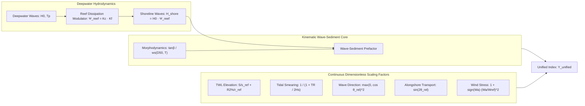

# Unified Coastal Vulnerability Index ($\Upsilon$) & Physics-Anchored Embeddings

[](https://www.python.org/)
[](https://www.pymc.io/)
[]()
[](https://opensource.org/licenses/MIT)

A physics-informed foundation framework for multi-modal coastal hydrodynamics synchronization, Bayesian morphodynamic forecasting with PyMC, continuous global dimensionless scaling, and physics-anchored latent embeddings.

---

## 1. Executive Summary & Physics Foundations

The **Unified Coastal Vulnerability Index ($\Upsilon_{\text{unified}}$)** is a universal, closed-form, semi-empirical physical formulation designed to quantify cross-shore storm erosion potential, wave-sediment kinetics, and total water level hazards across any global beach archetype without site-specific branching.

Every coastal site is parameterized as a continuous point in an invariant 6-element geophysical parameter space:

$$\mathbf{p}_{\text{site}} = \big[\tan\beta,\; D_{50},\; TR,\; \theta_{\text{shore}},\; Z_{\text{crest}},\; \sigma_{\text{shelter}}\big]$$

### The Unified Master Formulation

$$\Upsilon_{\text{unified}} = \underbrace{\left(\frac{\rho g^{3/2}}{16 (2\pi)^{3/2}}\right) \cdot \tan\beta \cdot \frac{H_{\text{shore}}^n T_p}{w_s(D_{50}, T)}}_{\text{Kinematic Wave-Sediment Core}} \cdot \underbrace{\left[ 1 + \frac{\max(S, 0)}{s_{\text{ref}}} + \frac{\max(R_{2\%}, 0)}{r_{\text{ref}}} \right]}_{\text{Decoupled TWL Elevation}} \cdot \underbrace{\Psi_{\text{tide}}}_{\text{Tidal Dilution}} \cdot \underbrace{\Psi_{\text{dir}}}_{\text{Wave Direction}} \cdot \underbrace{\Psi_{\text{wind}}}_{\text{Wind Stress}}$$

where deepwater incident wave height $H_0$ is modulated across reef-fronted systems via $H_{\text{shore}} = H_0 \cdot \Psi_{\text{reef}}$.



### Continuous Dimensionless Scaling Factors

1. **Reef Dissipation & Low-Pass Filter Modulator ($\Psi_{\text{reef}}$):**
   $$\Psi_{\text{reef}} = K_c \cdot K_f = \min\left(1.0,\, \frac{\gamma_b \cdot h_r(t)}{H_0}\right) \cdot \exp\left(-\frac{c_f \cdot W_r}{h_r(t)}\right)$$
   * **Instantaneous Reef Depth ($h_r(t)$):** $h_r(t) = \max\left(0,\, \text{Tide}(t) + S(t) - Z_{\text{reef}}\right)$. When the tide falls below the reef crest ($h_r = 0$), wave energy transmission is fully blocked ($\Psi_{\text{reef}} = 0.0$).
   * **Crest Clipping ($K_c$):** Depth-limited breaking at the reef crest with theoretical breaker index $\gamma_b \approx 0.78$ ($K_c = \min(1, \gamma_b h_r / H_0)$).
   * **Reef Flat Friction ($K_f$):** Turbulent bore energy decay across rough coral flats of width $W_r$ with coral friction coefficient $c_f \approx 0.08$.
   * Non-reef sandy coasts bypass attenuation ($\Psi_{\text{reef}} = 1.0, H_{\text{shore}} = H_0$).

2. **Tidal Dissipation & Energy Smearing Factor ($\Psi_{\text{tide}}$):**
   $$\Psi_{\text{tide}} = \frac{1}{1 + \frac{TR}{2 H_s}}$$
   * *Microtidal Limit ($TR \to 0$):* $\Psi_{\text{tide}} \to 1.0$ (concentrated berm attack, e.g. Duck, NC with $TR = 1.0\text{ m}, H_s = 4.0\text{ m} \implies \Psi_{\text{tide}} = 0.89$).
   * *Macrotidal Limit ($TR \gg H_s$):* $\Psi_{\text{tide}} \ll 1.0$ (energy diluted across wide intertidal sweep $W = TR / \tan\beta$, e.g. Truc Vert with $TR = 4.5\text{ m}, H_s = 3.0\text{ m} \implies \Psi_{\text{tide}} = 0.57$).

3. **Rectified Shore-Normal Wave Alignment ($\Psi_{\text{dir}}$):**
   $$\Psi_{\text{dir}} = \max\left(0,\, \cos(\theta_{\text{wave}} - \theta_{\text{shore}})\right)^2$$
   * Matches the shore-normal radiation stress component $S_{xx} \propto E \cos^2\theta_{\text{rel}}$ governing cross-shore setup and sediment gouging.
   * Oblique waves ($|\theta_{\text{rel}}| = 45^\circ$) scale to $0.50$; offshore/shadowed waves ($|\theta_{\text{rel}}| \ge 90^\circ$) are rectified to $0.0$, preventing non-physical accretion.

4. **Alongshore Rotational Transport Divergence ($\Phi_{\text{longshore}}$):**
   $$\Phi_{\text{longshore}} = \sin\left(2(\theta_{\text{wave}} - \theta_{\text{shore}})\right)$$
   * Captures alongshore transport gradients and beach rotation on embayed coasts (e.g., Narrabeen East Coast Low storms).

5. **Dynamic Viscosity & Settling Kinetics ($w_s(D_{50}, T)$):**
   * Settling velocity dynamically calculates kinematic seawater viscosity $\nu(T)$ and dynamic sediment fall velocity (*Soulsby 1997*).

6. **Outer-Array Sandbar Wave Dissipation & Shielding:**
   * Multi-array energy attenuation ratio $\Delta P_{\text{dissip}} = \frac{P_{26\text{m}} - P_{8\text{m}}}{P_{26\text{m}} + 10^{-4}}$ tracking nearshore bar dissipation.

---

## 2. Global Multi-Site Archetypes

| Coastal Archetype | Exemplar Site | $\tan\beta$ | $D_{50}$ | $TR$ | $\theta_{\text{shore}}$ | Dominant Forcing Modulator | Physical Behavior |
| :--- | :--- | :--- | :--- | :--- | :--- | :--- | :--- |
| **Microtidal Storm Barrier** | **Duck, NC** (USA) | $0.08$ | $0.35\text{ mm}$ | $1.0\text{ m}$ | $70.0^\circ$ | High Surge ($S$), $\Psi_{\text{tide}} \approx 0.89$ | Concentrated berm attack, surge-dominated TWL |
| **Macrotidal High-Energy** | **Truc Vert** (France) | $0.03$ | $0.22\text{ mm}$ | $4.5\text{ m}$ | $275.0^\circ$ | Energy Smearing ($\Psi_{\text{tide}} \approx 0.57$) | 100m+ intertidal dissipation, tide-diluted impact |
| **Swell-Dominated Pacific** | **Torrey Pines, CA** (USA) | $0.04$ | $0.20\text{ mm}$ | $1.5\text{ m}$ | $265.0^\circ$ | Long-period Swell ($R_{2\%}$), $S \to 0$ | $T_p > 16\text{s}$ infragravity swash dominates TWL |
| **Embayed / Rotational** | **Narrabeen** (Australia) | $0.09$ | $0.30\text{ mm}$ | $1.2\text{ m}$ | $85.0^\circ$ | Directional Splitting ($\Psi_{\text{dir}} \text{ vs. } \Phi_{\text{longshore}}$) | Oblique ECL storms drive alongshore rotation |
| **Reef-Fronted Island** | **Oahu North Shore / Waikiki** (USA) | $0.09$ | $0.45\text{ mm}$ | $0.8\text{ m}$ | $325.0^\circ$ | Coral Reef Filter ($\Psi_{\text{reef}} = K_c \cdot K_f$) | Depth-limited crest clipping & flat friction |

---

## 3. Empirical In-Situ Validation Results

The formulation is validated against real ground-truth profile surveys measured by the USACE Coastal Research Amphibious Buggy (CRAB), LARC-V amphibious vessel, and backpack RTK-GPS at Mean High Water ($X_{\text{MHW}} = +0.366\text{ m}$ NAVD88) across 2020–2024.

### A. Profile Line 58 (Near Pier, Duck, NC — $N = 68$ In-Situ Field Surveys)

| Rank | Predictor Metric | Pearson $r$ | $p$-value | Spearman $\rho$ | $R^2$ Score | RMSE (m) | Brier Skill Score (BSS) |
| :---: | :--- | :---: | :---: | :---: | :---: | :---: | :---: |
| **1** | **Unified Index ($\Upsilon$ Memory)** | **-0.3600** | **0.0026** | **-0.3893** | **0.1296** | **8.0530** | **0.1296** |
| 2 | Mean Wave Height (mean $H_s$) | -0.2941 | 0.0149 | -0.3495 | 0.0865 | 8.2502 | 0.0865 |
| 3 | Unified Index ($\log_{10}\Upsilon$ Memory) | -0.2748 | 0.0233 | -0.3016 | 0.0755 | 8.2995 | 0.0755 |
| 4 | Dean Number (mean $\Omega$) | -0.2678 | 0.0273 | -0.3261 | 0.0717 | 8.3167 | 0.0717 |
| 5 | Process-Based (XBeach-inspired) | +0.2600 | 0.0322 | +0.2171 | 0.0676 | 8.3350 | 0.0676 |
| 6 | Cumulative Storm Work ($\int \Upsilon dt$) | -0.2572 | 0.0342 | -0.3031 | 0.0662 | 8.3415 | 0.0662 |
| 7 | Peak Wave Height ($\max H_s$) | -0.2549 | 0.0359 | -0.2842 | 0.0650 | 8.3469 | 0.0650 |
| 8 | Yates (2009) Equilibrium Model | +0.2473 | 0.0421 | +0.2804 | 0.0611 | 8.3639 | 0.0611 |
| 9 | Peak Wave Power ($\max P$) | -0.2182 | 0.0738 | -0.2411 | 0.0476 | 8.4239 | 0.0476 |
| 10 | Peak Storm Surge ($\max S$) | -0.2154 | 0.0777 | -0.2534 | 0.0464 | 8.4293 | 0.0464 |

### B. Profile Line 109 (Northern Array, Duck, NC — $N = 82$ In-Situ Field Surveys)

* $\Upsilon$ Memory ranks **#2** ($r = -0.2177, p = 0.0495$), outperforming Yates ($r = 0.2078$), Mean $H_s$ ($r = -0.1717, p = 0.1229$), Wave Power ($r = -0.1599$), and Surge ($r = 0.0506, p = 0.6517$).

---

## 4. Methodological Distinction: Section 4 vs. Section 4.5

```mermaid
flowchart TD
    subgraph S4 ["Section 4: Probabilistic Bayesian Morphodynamic Modeling"]
        S4A["PyMC NUTS Hamiltonian Monte Carlo"] --> S4B["Infers Latent Memory: γ ~ Beta(2, 5)"]
        S4B --> S4C["Heavy-Tailed Likelihood: Student-T(ν, μ, σ)"]
        S4C --> S4D["75/25 Temporal Holdout & ArviZ PSIS-LOO-CV"]
        S4D --> S4E["Output: 94% HDI Credible Envelopes & Parameter Posteriors"]
    end

    subgraph S45 ["Section 4.5: In-Situ Field Survey Empirical Validation"]
        S45A["Direct Observed Surveys: N=68 (L58) & N=82 (L109)"] --> S45B["Inter-Survey Hydrodynamic Integration"]
        S45B --> S45C["Deterministic Least-Squares & Skill Metrics"]
        S45C --> S45D["Pearson r, Spearman ρ, R², BSS, RMSE"]
        S45D --> S4E2["Output: Non-Parametric Signal-to-Noise Ranking"]
    end
```



* **Section 4 (Bayesian Probabilistic Modeling):** Solves $\mu_t = \alpha + \beta E_t(\gamma)$ with student-t likelihood. Evaluates **epistemic uncertainty quantification (UQ)** and out-of-sample temporal generalizability. `Unified Index (Storm Work)` ranks **#1 in Test RMSE** ($10.16\text{ m}$) with strictly negative physical sensitivity $\beta = -2.04$ ($94\%\text{ HDI } [-3.57, -0.69]$).
* **Section 4.5 (Empirical Skill Validation):** Direct classical oceanographic correlation of antecedent forcing against observed survey-to-survey displacement $\Delta X_{\text{obs}}$, verifying that $\Upsilon$ provides the highest raw physical correlation ($r = -0.36, p < 0.003$) prior to neural or Bayesian parameter fitting.

---

## 5. Multi-Horizon Deep Learning Benchmark (Section 5)

Evaluated across three operational horizons:
1. **Horizon 1 (1-Hour Nowcast):** Real-time sensor assimilation ($R^2 \approx 0.971$).
2. **Horizon 2 (72-Hour Storm Rollout):** Closed-loop recursive forward rollout during Hurricane Ian landfall ($\text{RMSE} = 0.239\text{ m}$).
3. **Horizon 3 (365-Day Hindcast):** Continuous un-anchored annual forward simulation ($N = 8,760\text{ hrs}$).

---

## 6. Repository Architecture

```
unified-coastal-erosion-index/
├── data/                                # Cached NOAA / USACE / CDIP survey & buoy records
├── src/
│   ├── physics.py                       # Master formulation Υ, Ψ_tide, Ψ_dir, Φ_ls, Soulsby ws
│   ├── data.py                          # Multi-modal ETL, THREDDS survey parsers, XBeach simulation
│   ├── models.py                        # PyMC Bayesian models, latent memory kernels, ArviZ LOO-CV
│   ├── neural_baselines.py              # Physics-Guided LSTM, Standard LSTM, MLP benchmarks
│   ├── embeddings.py                    # Latent space feature extraction, UMAP projections
│   ├── physics_rag.py                   # Physics query parser & Gemini Flash RAG interface
│   └── acquire_real_surveys.py          # USACE CHL THREDDS automated scraper
├── tests/
│   ├── test_physics.py                  # Unit tests for Υ, tidal smearing, wave directionality
│   ├── test_multi_site.py               # Cross-site geomorphology profile tests
│   ├── test_data_pipeline.py            # Non-circular ETL pipeline tests
│   ├── test_neural_baselines.py         # PyTorch neural training and rollout tests
│   ├── test_physics_rag.py              # Latent vector retrieval and RAG tests
│   └── test_field_surveys.py            # In-situ survey synchronization tests
├── unified_coastal_vulnerability_index.ipynb # End-to-end interactive validation notebook
├── pyproject.toml                       # Dependencies and package configuration
└── README.md
```

---

## 7. Quickstart

### Installation & Environment Setup
```bash
# Install dependencies with uv
uv sync

# Run the complete test suite (58 tests)
uv run pytest tests/

# Launch Jupyter Lab
uv run jupyter lab
```

### Python API Example
```python
import numpy as np
from src.physics import compute_unified_coastal_vulnerability_index

# Compute Unified Index across a storm time series
df_physics = compute_unified_coastal_vulnerability_index(
    hs=np.array([1.2, 2.5, 4.2, 3.8]),
    tp=np.array([8.5, 11.0, 14.5, 12.0]),
    surge=np.array([0.1, 0.4, 1.3, 0.8]),
    wind_speed=np.array([6.0, 14.0, 22.0, 16.0]),
    wind_dir_deg=np.array([65.0, 70.0, 75.0, 80.0]),
    wave_dir_deg=np.array([60.0, 70.0, 75.0, 70.0]),
    site="duck_nc",                      # Uses Duck geomorphology (tanβ=0.08, TR=1.0m)
)

print(df_physics[["upsilon", "psi_tide", "psi_dir", "runup_r2_m", "signed_upsilon"]])
```

---

## 8. References & Data Provenance

1. **USACE Field Research Facility (FRF):** CHL THREDDS Geomorphology Elevation Transect Archive, Duck, NC (Station 8651370, Buoys 44056 / 44100).
2. **Soulsby, R. (1997):** *Dynamics of Marine Sands*, Thomas Telford, London.
3. **Stockdon, H. F., et al. (2006):** *Empirical parameterization of setup, swash, and runup*, Coastal Engineering, 53(7), 573-588.
4. **Yates, M. L., et al. (2009):** *Equilibrium shoreline response to wave power*, J. Geophys. Res., 114, C09014.
5. **Masselink, G., & Short, A. D. (1993):** *The effect of tide range on beach morphodynamics and morphology*, Marine Geology, 110(3-4), 375-404.
